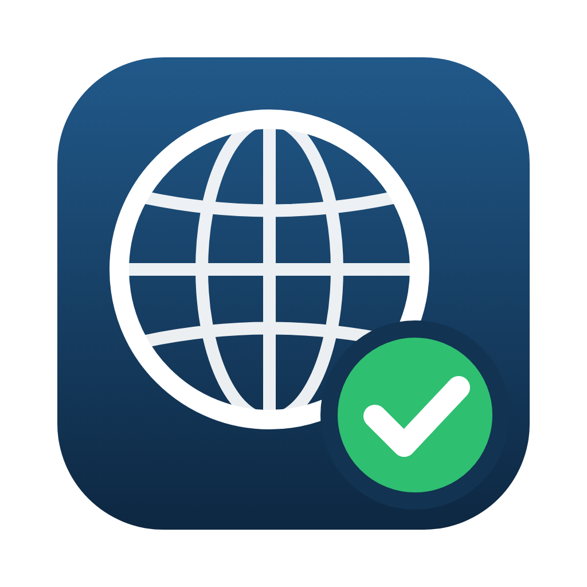

<p align="center"></p>

# NetMonitor

macOS 菜单栏工具：同时向多个境内、境外的 IP 查询接口发请求，检查每条出口的公网 IP 是否符合预期地区或关键字，不符合时通知或弹窗提醒。

适合开着代理 / 分流规则的场景：访问不同国家的网站会走不同出口，任何一条出口漂移、掉线回落直连、IPv6 泄漏都能及时发现。

## 功能

- **检测点**：一个检测点 = 一个查询接口 + 一组预期规则。查询接口决定请求走哪条出口，主接口失败时按顺序回退到备用接口。
- **内置接口**：境内（IPIP.net、IP9、太平洋 IP 库）、境外（Cloudflare trace、IP.SB、ipwho.is、ipinfo.io）、IPv6（ident.me、icanhazip）。也可添加自定义接口（JSON 字段路径 / key=value / 纯文本）。
- **规则**：国家码属于 / 不属于，地区、城市、运营商、ASN、IP、原始响应的包含 / 不包含 / 等于 / 正则；按“全部满足”或“任一满足”组合。
- **防误报**：连续 N 次不符合才提醒；只在状态变化时通知；恢复时通知；持续异常可重复提醒；“检测失败”与“不符合”分开处理。
- **提醒方式**：菜单栏图标变化、系统通知、置顶强提醒弹窗（不受专注模式影响）、提示音。
- **触发**：定时检测、手动检测、网络变化（切换 Wi‑Fi、VPN 上下线）与唤醒后自动补测。
- **历史记录**：记录不符合、恢复、检测失败和 IP 变化，可导出 CSV。

设计文档见 [docs/requirements.md](docs/requirements.md)，接口清单与实测记录见 [docs/endpoints.md](docs/endpoints.md)。

## 安装

需要 macOS 13 或更高版本，Apple 芯片和 Intel 芯片都支持。

> **为什么会被系统拦截**：安装包只做了临时签名，没有经过 Apple 公证（公证需要付费的 Apple 开发者账号）。从网上下载的 App 会被系统打上“隔离”标记，第一次打开时提示 “Apple 无法验证 NetMonitor 是否包含恶意软件”。这不代表程序有问题，按下面任一方法放行一次即可，之后正常打开。源代码全部公开，介意的话可以[从源码构建](#从源码构建)。

### 第 1 步：下载

任选一处：

- **Releases 页面**（推荐，无需登录）：在仓库右侧的 Releases 里下载最新的 `NetMonitor-版本号.zip`。
- **Actions 构建产物**（每次提交都会生成，需要登录 GitHub）：打开仓库的 Actions 页面，点开最近一次成功的 CI，在页面底部 Artifacts 处下载 `NetMonitor`。下载到的是一个 zip，里面还套着一个 `NetMonitor-*.zip`，需要解压两次。

### 第 2 步：安装并放行

**方法 A：一键安装脚本（推荐）**

在终端执行，脚本会自动找到“下载”文件夹里最新的安装包，解压、复制到“应用程序”、解除隔离标记并启动：

```bash
curl -fsSL https://raw.githubusercontent.com/arschlochnop/netMonitor/HEAD/scripts/install.sh | bash
```

安装包不在“下载”文件夹时，把路径传给脚本：

```bash
curl -fsSL https://raw.githubusercontent.com/arschlochnop/netMonitor/HEAD/scripts/install.sh | bash -s -- ~/Desktop/NetMonitor.zip
```

**方法 B：手动安装 + 终端放行**

1. 双击 zip 解压（Actions 产物要解压两次），得到 `NetMonitor.app`。
2. 把 `NetMonitor.app` 拖进“应用程序”文件夹。
3. 在终端执行：

   ```bash
   xattr -dr com.apple.quarantine /Applications/NetMonitor.app
   ```

4. 双击打开。

**方法 C：手动安装 + 系统设置放行**（不用终端）

1. 解压并拖进“应用程序”，双击打开，出现拦截提示后点“完成”。
2. 打开“系统设置 › 隐私与安全性”，滚到底部“安全性”一栏，会看到“已阻止使用 NetMonitor”。
3. 点“仍要打开”，输入登录密码，再在弹出的确认框里点“仍要打开”。

> 在较新的 macOS 上，右键选“打开”已经不能绕过这个提示，只能用上面的方法。

### 第 3 步：首次运行

- NetMonitor 没有 Dock 图标和主窗口，打开后只在**菜单栏右上角**出现一个地球图标，点它查看各检测点状态。
- 第一次运行会请求**通知权限**，请点“允许”。拒绝的话，不符合时改用置顶弹窗提醒；之后可以在“系统设置 › 通知 › NetMonitor”里重新打开。
- 想开机自动运行：菜单栏图标 › 设置… › 通用 › 勾选“登录时自动启动”。

### 升级与卸载

- **自动更新**：程序每 6 小时检查一次 GitHub Releases，有新版本时菜单里会出现“有新版本，立即更新”。点击后自动下载、核对 SHA-256、替换并重启。在“设置 › 更新”中可以手动检查、跳过某个版本，或开启“自动下载并安装”。自动更新需要仓库公开且已发布 Release。
- **手动升级**：用同样的方法安装新版本覆盖即可，配置和历史记录会保留。一键脚本会先退出正在运行的旧版本。
- **卸载**：退出 NetMonitor，删除 `/Applications/NetMonitor.app`。如需同时删除配置和历史：

  ```bash
  rm -rf ~/Library/Application\ Support/NetMonitor
  ```

## 从源码构建

需要 Xcode 15 或更高版本的命令行工具。

```bash
swift test
```

```bash
scripts/build-app.sh 0.1.0
```

产物在 `build/NetMonitor.app`。也可以 `swift run NetMonitor` 直接运行调试，但这种方式没有 Bundle ID，系统通知和开机启动不可用。

## 发布新版本

推送 `v` 开头的标签即可，CI 会编译、打包并创建 Release，附上安装包和 `.sha256` 校验文件：

```bash
git tag v0.2.0
```

```bash
git push origin v0.2.0
```

## 配置与数据

- 配置：`~/Library/Application Support/NetMonitor/config.json`，可在设置中导入 / 导出。
- 历史：`~/Library/Application Support/NetMonitor/history.jsonl`，默认保留 30 天。

所有数据只存在本机。程序只向你配置的查询接口发请求，没有遥测。

## 验证接口

`scripts/check-endpoints.sh` 会逐个请求内置接口并打印响应，用于在你的网络环境下确认接口可用、分流是否符合预期。

## 许可证

[MIT](LICENSE)
